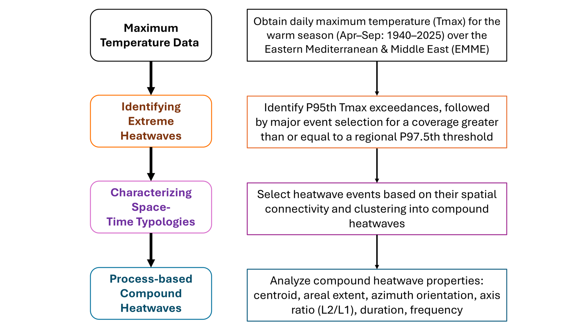
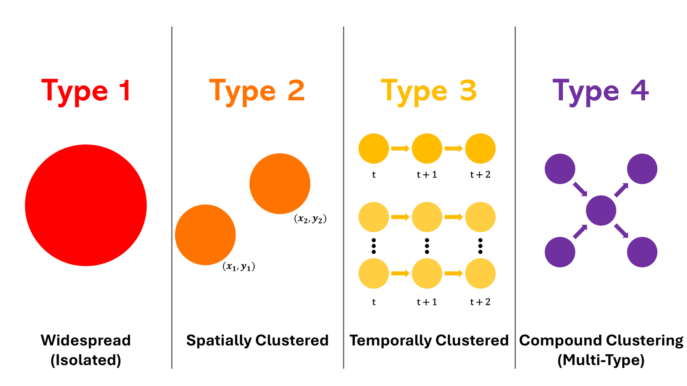

# scoRch.generator

[](https://github.com/fawazbouhamad/scoRch.generator/actions/workflows/R-CMD-check.yaml)
[](https://github.com/fawazbouhamad/scoRch.generator/actions/workflows/demo.yaml)
[](LICENSE.txt)
[](NEWS.md)

**scoRch.generator** finds large, regionally extensive heatwaves in gridded
daily maximum temperature and classifies them into four space-time types. It
is the R implementation of **SCORCH** (Spatiotemporal Classification of
Regional Compound Heatwaves), the method of *Understanding Compound Space-Time
Typologies of Large-Scale Extreme Heatwaves* by Fawaz Bouhamad and Nasser
Najibi (manuscript in preparation).

**Two repositories, two roles.** This repository is the *software*: an R
package that applies the SCORCH method to any gridded daily maximum
temperature dataset, with its tests, documentation and demo. The study's
*research record* (the scripts that produced the published catalogs,
tables and figures, and those results themselves) lives in
[compound-heatwave-typologies-SCORCH](https://github.com/fawazbouhamad/compound-heatwave-typologies-SCORCH),
and the study's processed input is the Zenodo dataset
[10.5281/zenodo.21717874](https://doi.org/10.5281/zenodo.21717874). The
package is verified against that record (see [Verification](#verification)).

## Quick start

| | |
|---|---|
| **You provide** | ERA5 2-m temperature downloaded as NetCDF (hourly or daily; one file, several files or a folder), or a file of daily maximum temperature |
| **You may edit** | `scorch_config.yaml`, the one configuration file. It starts with the settings of the SCORCH study; change only what your application needs |
| **You run** | `run_scorch("scorch_config.yaml")` |
| **You get** | eight XLSX workbooks (catalogs, summary tables, model results), nine figures and a plain-language `README.txt` in `results/` |

```r
library(scoRch.generator)
write_scorch_config("scorch_config.yaml")   # 1. an editable copy of the SCORCH configuration
                                            # 2. in scorch_config.yaml, set  input: file: 'my_era5_folder'
run_scorch("scorch_config.yaml")            # 3. the complete SCORCH analysis
```

That one command reads and prepares the ERA5 data (daily maxima, degrees
Celsius, 1-degree cells), runs every SCORCH stage, fits the models, chooses
the representative events, draws the figures and writes everything to the
output folder. You never edit the package's R source files: every setting a
user can change is in `scorch_config.yaml`. The [`demo/`](demo) folder shows
the whole workflow on the demonstration data.

## What it does

<p align="center"></p>

*Workflow artwork by Bouhamad and Najibi, CC BY 4.0, from the
[reproducibility repository](https://github.com/fawazbouhamad/compound-heatwave-typologies-SCORCH).*

1. **Local heatwaves** in every grid cell: days at or above the cell's
   95th-percentile Tmax, in runs of at least 3 days with single-day gaps
   bridged (Catalog 1).
2. **Regionally extensive days**: dates whose number of heatwave cells reaches
   the 97.5th percentile of all days (Catalog 2).
3. **Clusters** of the heatwave cells on each selected day with DBSCAN, whose
   neighbourhood settings are chosen by a parameter search and pooled over
   consecutive days (Catalog 3).
4. **Ellipses** fitted to each cluster by principal components, with
   temperature-weighted centroids (Catalog 4).
5. **Compound heatwave events**: consecutive selected days, classified into the
   four types below (Catalog 5 and Table 1).

The largest ellipse areas are then fitted with a power law, and the centroids
with a log-Gaussian Cox process whose intensity map shows where large
heatwaves concentrate.

<p align="center"></p>

*Typology artwork by Bouhamad and Najibi, CC BY 4.0. Type 1 has one selected day and one cluster;
Type 2 has one selected day and several clusters; Type 3 has several days that consistently have
one cluster or consistently have several; Type 4 mixes daily cluster counts, including a selected
day on which no cluster forms.*

## Installation

The package is pure R (no compilers needed) and installs its dependencies
(`dbscan`, `maps`, `ncdf4`, `spatstat.geom`, `spatstat.model`, `yaml`)
automatically. R 4.1 or newer is required.

```r
install.packages("remotes")
remotes::install_github("fawazbouhamad/scoRch.generator")
```

## Try the demonstration

The package ships a demonstration dataset: ERA5-derived daily maximum 2-m
temperature on 25 x 72 one-degree cells between 25 N and 50 N and between
130 W and 58 W, every April-September day of 1996-2025 (1,800 cells, 5,490
dates, 12 MB). The box holds the contiguous United States with southern
Canada, northern Mexico, the Great Lakes and the adjacent Pacific, Atlantic
and Gulf of Mexico waters; it is a regional sample, not all of North America.
[`inst/extdata/README.md`](inst/extdata/README.md) gives its exact source,
licence, processing and verification, and [`data-raw/`](data-raw) the script
that rebuilds it.

```r
library(scoRch.generator)
scorch_template("scorch_config.yaml", fast = TRUE)  # 1. write a config for the demonstration data
run_scorch("scorch_config.yaml")                    # 2. run; results appear in results/
```

The run takes about half a minute and prints what it found: 29 compound
heatwave events of all four types in these 30 seasons. `fast = TRUE` writes a
clearly labelled **fast demonstration** with 200 bootstrap repetitions in the
power-law analysis instead of the study's 5000; it is for learning and
testing, not for results. A commented step-by-step walk-through of the same
data with the study's settings, one real heat wave (28 June to 4 July 2012)
traced from the temperature data through the catalogs to its figure, the
expected output, and an offline example of the from-scratch path are in
[`demo/`](demo) (`Rscript demo/run_demo.R`, then
`Rscript demo/cds_processing_example.R`).

## Use your own data

### 1. Provide the temperature data

There are two paths, chosen with `input: source` in the configuration:
**from scratch** (`source: cds`), where the package downloads ERA5 from the
Climate Data Store for your area and period, reduces it to 1-degree cells,
saves the result and runs; or a **ready file** (`source: file`, the default),
where `input: file` names a daily maximum temperature file, or raw ERA5
files you downloaded yourself, and the package reads it.

#### From scratch: download ERA5 from the Climate Data Store

One-time setup on each computer:

1. Create a free account at the
   [Copernicus Climate Data Store](https://cds.climate.copernicus.eu), open
   the dataset page of *ERA5 post-processed daily statistics on single
   levels from 1940 to present* and accept its licence.
2. Install the two optional packages, `install.packages(c("ecmwfr", "httr"))`,
   then, in an interactive R session, run `ecmwfr::wf_set_key()` with no
   arguments: it opens your CDS profile page and asks for the Personal
   Access Token at a hidden prompt, so the token goes straight into the
   operating system's keychain (Windows Credential Manager, macOS Keychain,
   or an encrypted file on Linux after `options(keyring_backend = "file")`)
   without passing through a script or the R command history. Do not type
   the token as an argument in a script or at the console. It never goes
   into a configuration file, the code, the logs or the run summary, and
   nothing of it belongs in a repository.

Then, in your configuration:

```yaml
input:
  source: cds
  cds:
    area: [50, -130, 25, -58]      # North, West, South, East, in degrees, multiples of 0.25
    cache_directory: era5_cache    # downloaded files are kept and reused
    request_period: month          # one CDS request per calendar month
    processed_file: era5_tmax_1deg.nc   # the reduced file written before the analysis
period:
  warm_season_months: [4, 5, 6, 7, 8, 9]   # [11, 12, 1, 2, 3] for a season across the new year
  start_date: "1996-01-01"
  end_date: "2025-12-31"
```

`run_scorch()` then requests, for every calendar month of the season, the
CDS product *ERA5 post-processed daily statistics*: the daily maximum of the
hourly 2-m temperature over each UTC calendar day on the native 0.25-degree
grid. Every file is cached in `cache_directory` under a name that states the
area and the requested dates, with a record of the complete request beside
it, and is reused only when its name, its record and its actual grid and
dates match: changing the area, the period or the months with the same
cache folder never reuses an old file. An interrupted run resumes where it
stopped, and a request still queued on the CDS is picked up again. The files are reduced to the daily maximum
temperature on 1-degree cells (steps 2 and 3 below) and saved with
`write_tmax()` as `processed_file`, a Celsius NetCDF file that later runs can
use directly with `source: file`. The same can be done in R with
`fetch_era5_daily_tmax()`, `read_era5()` and `write_tmax()`.

What to expect from the CDS: each request waits in its queue before it runs,
typically minutes and sometimes hours, and the CDS accepts one queued request
per user for this product, so the months go one after another. A 30-year
season of six months is 180 monthly requests, which can take days; leave the
run going, or stop it and run again later. A request that the CDS refuses as
too large (`request_period: year` with a big area) is reported with the
advice to use monthly requests. The run summary records the area and period
but no credential.

#### ERA5 files you downloaded yourself

Download ERA5 2-m temperature from the
[Copernicus Climate Data Store](https://cds.climate.copernicus.eu) in NetCDF
format and set `input: file` to the file, a list of files, or the folder that
holds them. The package prepares it exactly as the SCORCH study did.

| Item | Accepted |
|---|---|
| Product | *ERA5 hourly data on single levels*, variable *2m temperature* (`t2m`); or *ERA5 post-processed daily statistics*, daily maximum of *2m temperature* |
| Format | NetCDF (`.nc`), as downloaded; GRIB is not read |
| Time step | hourly, any step that divides a day (for example 3-hourly), or daily |
| Region | the area to analyse, downloaded with its edges included (for the study: North 46, West 20, South 10, East 70; for the demonstration data: North 44, West -104, South 34, East -94); regular 0.25-degree ERA5 grid |
| Files | one file, several files (for example one per year or month), or a folder of `.nc` files; each file holds whole days (UTC) on the same grid, and no date appears in two files |
| Contents | `t2m` in Kelvin with the dimensions `longitude`, `latitude` and `valid_time` (current CDS) or `time` (older CDS files); packed values, missing values and the ERA5/ERA5T `expver` dimension are handled |

The package then, for the analysed months only:

1. takes the **maximum of each UTC calendar day** at every ERA5 grid point
   (every analysed day must be complete, e.g. 24 hours);
2. converts **Kelvin to degrees Celsius**;
3. **averages the daily maxima to 1-degree cells** (`era5_cell_size_deg: 1`):
   a cell holds the points `k <= coordinate < k + 1` in both directions and
   only complete cells are kept, so a 20-70 E, 10-46 N download gives the
   50 x 36 study cells and the demonstration's 104-94 W, 34-44 N download
   gives its 10 x 10 cells. Longitudes from 0 to 360 are converted to -180 to 180,
   and north-to-south latitudes are put in order.

`README.txt` records this preprocessing. The R function behind it,
`read_era5()`, can also be used on its own.

#### Daily maximum temperature

One NetCDF file with daily maximum temperature on a regular
longitude-latitude grid (`format: daily_tmax`, chosen automatically when the
file has no `t2m` variable), used as it is:

| Item | Requirement |
|---|---|
| Variable | Daily maximum temperature, 3 dimensions: time, latitude, longitude (any order) |
| Units | `units` attribute `degC` or `K` (Kelvin is converted), or set `units` in the config |
| Coordinates | Cell centres in degrees, evenly spaced; the grid step is read from the file |
| Time | `days since YYYY-MM-DD` (or hours/minutes/seconds since), standard Gregorian calendar; all days of the year or only the warm season |
| Missing values | `_FillValue`/`missing_value` attribute. Cells missing on every date (for example sea cells) are excluded; any other gap stops the run, because the method needs a complete record |

The study's temperature-weighted centroids use Celsius Tmax as weights. Every
cluster cell must therefore have positive Celsius Tmax. A colder region needs
a different, explicitly chosen weighting rule before this stage can be used.

The study's processed file, `scorch_data/tmax_processed.nc` in `SCORCH_data.zip`
(Zenodo, version 1.0.0, [doi:10.5281/zenodo.21717874](https://doi.org/10.5281/zenodo.21717874)), works as is. Data already in R (for example from another file format) can be
wrapped with `tmax_from_array()` and passed as
`run_scorch("scorch_config.yaml", tmax = my_tmax)`, or as
`run_scorch(tmax = my_tmax)` to use the study settings unchanged. The
configuration's warm-season months and date limits apply to this R input too.

### 2. Choose the settings

The package ships with the configuration of the SCORCH study, and its
settings are the defaults. Run with them as they are, or change individual
settings for your own application. Write an editable copy to your working
folder:

```r
write_scorch_config("scorch_config.yaml")   # the study settings, 5000 bootstrap repetitions
```

Open the file in any text editor. Every setting is commented. Set
`input: file` to your data; you normally change only that and the output
folder. A setting you delete from the file keeps its study value. These are
all the settings:

| Setting | Meaning | Study default |
|---|---|---|
| `input: source` | `file` (the data named in `input: file`) or `cds` (download ERA5 from the Climate Data Store with the `cds` settings) | file |
| `input: file` | your ERA5 file, list of files or folder, or a daily maximum temperature file | - |
| `input: format` | `era5`, `daily_tmax`, or `auto` (ERA5 when the file has `t2m`) | auto |
| `input: variable`, `longitude`, `latitude`, `time`, `units` | names in the file and temperature units; found automatically unless set | auto |
| `input: era5_cell_size_deg` | ERA5 and CDS only: cell size (degrees) to which the daily maxima are averaged; `null` keeps the ERA5 grid | 1 |
| `input: cds` | from scratch only: `area` [North, West, South, East], `cache_directory`, `request_period` (`month` or `year`), `processed_file` | - |
| `output: directory` | folder for the results | `results` |
| `period: warm_season_months` | months analysed; `start_date`, `end_date` limit the period | April-September |
| `heatwaves` | local threshold percentile, minimum duration, minimum exceeding days | 95, 3, 3 |
| `regional_days: percentile` | percentile of daily heatwave-cell counts that selects a day | 97.5 |
| `clustering` | candidate DBSCAN distances (grid-cell units) and minimum sizes | 1-4 by 0.5; 4-12 |
| `ellipses: scale_factor` | ellipse semi-axis per principal standard deviation | 1.25 |
| `power_law` | bootstrap repetitions and seeds | 5000 |
| `lgcp` | trend covariates, raster pixel size, window margin | lon, lat, mean and SD of Tmax; 25 km; 80 km |
| `figures: representative_events` | events shown in the single-day and multi-day example plots; `null` = longest event of each type | automatic |

### 3. Run

```r
run_scorch("scorch_config.yaml")
```

### 4. Open the results

```
results/
  Heatwave_Catalogs/
    Heatwaves.xlsx            Heatwave Events: every local heatwave (Catalog 1)
    Regional_Heatwaves.xlsx   Regional Days; Regional Day Cells (Catalog 2)
    Heatwave_Clusters.xlsx    Clusters; Cluster Cells (Catalog 3, DBSCAN)
    Heatwave_Ellipses.xlsx    Ellipses: geometry and weighted centroids (Catalog 4)
    Compound_Heatwaves.xlsx   Compound Events (with their type); Event Days (Catalog 5)
  Modelling/
    Power_Law.xlsx            Power Law Fits: cutoffs, exponents, bootstrap p-values
    LGCP.xlsx                 Parameters; Intensity (per cell); Centroid Concentration
  Additional_Results/
    Analysis_Summary.xlsx     Event Type Summary (the statistics by type reported as
                              Table 1 of the study); Cell Thresholds; Daily Heatwave
                              Extent; Duration Trends
  figures/
    ellipse_spatial_patterns.png          maps of ellipse axes, overlap and geometry
    single_day_events.png                 examples of Type 1 and Type 2 events
    consistent_multiday_events.png        example of a Type 3 event
    mixed_multiday_events.png             example of a Type 4 event
    ellipse_geometry_by_type.png          geometry histograms and box plots
    event_geometry_distributions.png      geometry distributions by event type
    annual_event_counts_and_duration.png  event counts and duration trends
    ellipse_area_power_law.png            fitted area distributions
    centroid_concentration.png            fitted centroid intensity map
  README.txt                  input, settings, counts, models, files, run time, warnings
```

Every sheet holds all rows and columns of its table: dates as date cells,
numbers as numeric cells (stored with the 15 significant digits of the XLSX
format; the display formats only round for reading), missing values as empty
cells, with a frozen and filtered header row and readable widths. A table
longer than an XLSX sheet, or a file that cannot be written, stops the run
with an error rather than losing rows. The workbooks are written with openxlsx2, and every archive is checked
after writing (relationship targets, sheet dimensions, sheet names) so
that readers stricter than Excel, such as Python's openpyxl, open them;
`README.txt` is written in UTF-8 whatever the locale of the session.

Plots adapt to your region, period and the event types present; a plot
whose events do not exist is skipped with a reason in `README.txt`. An
LGCP fit can also be unavailable for sparse datasets; `README.txt` records why
and its dependent plot is skipped. The paper's workflow,
threshold diagnostic (Figure 2) and typology artwork are not generated as
results. A run with no clusters writes only the first three catalog workbooks
and the cell and day tables, with a `README.txt` that marks the run
incomplete; it replaces old package-generated output so stale
results cannot appear to belong to the new run. `run_scorch()` also returns the
results in R, where `scorch_figure(result, name = "mixed_multiday_events")` redraws a plot and the
stage functions (`fetch_era5_daily_tmax()`, `read_era5()`, `read_tmax()`, `write_tmax()`,
`detect_heatwaves()`, `select_regional_days()`, `cluster_heatwaves()`, `fit_ellipses()`,
`classify_events()`, `fit_power_law()`, `fit_lgcp()`) can be run one at a time.

## Verification

The R implementation was checked against the study's independent
reproducibility workflow: with the study's final processed input and settings
it reproduces all 176,061 local heatwaves, 395 selected days, 753 clusters,
753 ellipses (geometry to 1e-9, centroids to 1e-7), 51 compound events,
Table 1, the power-law cutoffs, exponents and bootstrap p-values, and the LGCP
parameters (to 1e-6). The test suite (`tests/testthat`) covers the
calculations with fixtures taken from the final reference catalogs, the ERA5
preprocessing, and the complete demonstration workflow; the full-study comparison
(`tests/testthat/test-reference-study.R`) runs when `SCORCH_REFERENCE_DIR`
names a clone of the
[reproducibility repository](https://github.com/fawazbouhamad/compound-heatwave-typologies-SCORCH)
with the Zenodo file placed at `input/tmax_processed.nc`, and the 5000-repetition
bootstrap check runs with `SCORCH_LONG_TESTS=1`. The last verification, on
12 October 2026 with version 1.0.0, is recorded in
[`docs/verification_record.md`](docs/verification_record.md).

**Preprocessing correction.** The study's first processed input (historical,
superseded Zenodo record doi:10.5281/zenodo.21717752) contained a partial northern boundary cell: the
historical ERA5 extraction ended at 45.0 N while the 1-degree aggregation
retained a cell centred at 45.5 N, so that row averaged only the four
0.25-degree points at 45.0 N. The final input (doi:10.5281/zenodo.21717874)
builds every 1-degree cell from the full 4 x 4 set of native ERA5 points; only
the 50 cells of the 45.5 N row differ. The correction changes some event
classifications and summary statistics (753 instead of 760 clusters; three of
the 51 compound events change type, giving 3/3/20/25 events of Types 1-4
instead of 3/4/20/24) but not the principal qualitative conclusions. The
historical input and results remain archived for audit; the historical
analysis is still reproduced when `SCORCH_HISTORICAL_REFERENCE_DIR` names it.

`read_era5()` applies the same complete-cell rule. On hourly ERA5 for 9-10
August 2001, from the same source the study used, it reproduces the final
input in all 1,800 cells to 1e-5 degrees C (2e-4 degrees C from 16-bit packed
CDS files, their storage precision).

## Citation

Please cite the software and the study it implements. In R,
`citation("scoRch.generator")` prints both; [`CITATION.cff`](CITATION.cff)
holds the same metadata (GitHub shows a "Cite this repository" button) and
[`codemeta.json`](codemeta.json) the machine-readable description.

- **Software:** Bouhamad, F., and Najibi, N. (2026). *scoRch.generator:
  Spatiotemporal Classification of Regional Compound Heatwaves*. R package
  version 1.0.0. https://github.com/fawazbouhamad/scoRch.generator. A Zenodo
  software DOI will be added once the release is archived
  ([`docs/release_checklist.md`](docs/release_checklist.md)).
- **Dataset:** Bouhamad, F., and Najibi, N. (2026). *Processed ERA5 daily
  maximum temperature data for SCORCH, 1940-2025* (version 1.0.0) [dataset].
  Zenodo. https://doi.org/10.5281/zenodo.21717874

Until the manuscript is published, please cite the study as:

Bouhamad, F., and Najibi, N. *Understanding Compound Space-Time Typologies of
Large-Scale Extreme Heatwaves*. Manuscript in preparation.

```bibtex
@unpublished{bouhamad_najibi_scorch,
  title  = {Understanding Compound Space-Time Typologies of Large-Scale Extreme Heatwaves},
  author = {Bouhamad, Fawaz and Najibi, Nasser},
  note   = {Manuscript in preparation},
  url    = {https://github.com/fawazbouhamad/compound-heatwave-typologies-SCORCH}
}
```

Data derived from ERA5 contain modified Copernicus Climate Change Service
information; cite Hersbach et al. (2020).

## Development notes

Version 1.0.0 is the first public release ([`NEWS.md`](NEWS.md)). The
scientific method, the R implementation of the five stages and the models,
and their study-reproduction tests are the authors' work. The release
packaging (citation and archiving metadata, checklists, verification
record), the from-scratch input path, the demonstration data build from the
authors' own ERA5-derived files, the demo with its traced event, the figure
styling and the documentation were written with the assistance of an AI
coding tool (Claude Code by Anthropic), operated and reviewed by Fawaz
Bouhamad; the scientific calculations and results are the authors' own.
[`docs/ai_assistance_record.md`](docs/ai_assistance_record.md) lists what the
tool wrote. The repository's public history begins with this release in a
single commit, at the maintainer's decision.

## Support and contributing

- Problems installing or running the package: open an issue in the
  [Issues tab](https://github.com/fawazbouhamad/scoRch.generator/issues).
- Scientific questions: contact Fawaz Bouhamad or
  [Nasser Najibi](https://nassernajibi.com/).
- Contributions are welcome; see [CONTRIBUTING.md](CONTRIBUTING.md).

## Licence

Code: [GPL (>= 3)](LICENSE.txt). The demonstration data are CC BY 4.0 for the authors'
processing and contain modified Copernicus Climate Change Service information
2026 under the [Copernicus licence](https://ecds.ecmwf.int/licences/licence-to-use-copernicus-products).
The workflow and typology artwork above are CC BY 4.0 by the authors. Map outlines come
from Natural Earth (public domain) through the `maps` package.

**Disclaimer:** the software is provided *as is*, without warranty of any
kind. The authors are not liable for damages arising from its use. The views
expressed here are those of the authors and do not necessarily reflect those
of funding agencies, affiliated universities or the U.S. Government.
