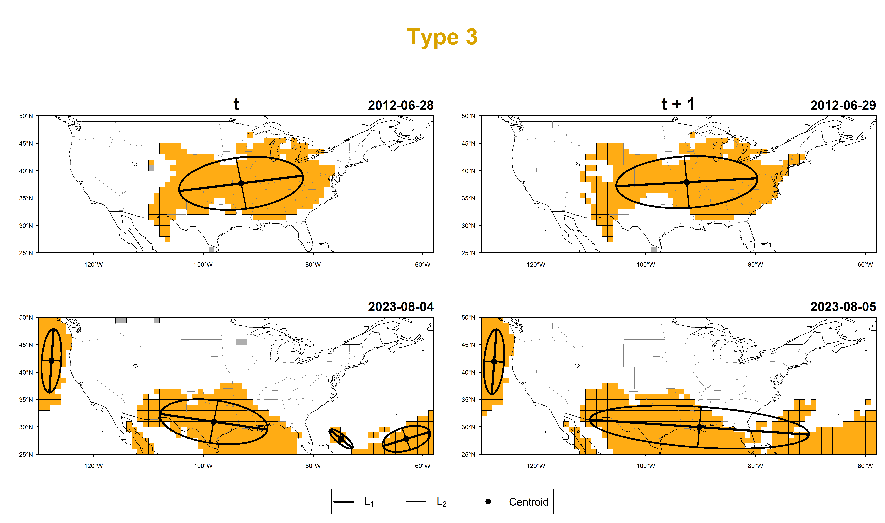

# Demonstration: the whole SCORCH analysis on North America in half a minute

This folder runs the complete analysis on the data shipped with the package,
the way it is run on any dataset: temperature data, one configuration file
and one command. It is meant as a first walk-through for students and new
users. A second script shows, offline, what the from-scratch path does with a
file downloaded from the Climate Data Store.

| File | What it is |
|---|---|
| [`run_demo.R`](run_demo.R) | the commented demonstration: reads the data, runs `run_scorch()`, prints what was found, traces one real heat wave from the temperature data to its figure, then repeats the analysis one stage at a time |
| [`scorch_config.yaml`](scorch_config.yaml) | the configuration: it names the input data, the output folder and the events to show in the figures; every other setting keeps its SCORCH study value |
| [`cds_processing_example.R`](cds_processing_example.R) | the from-scratch path without a CDS account: reduces the shipped CDS file to 1-degree cells and compares them with the demonstration data |
| [`compare_output.R`](compare_output.R) | compares a run's `results/` with `expected_output/` sheet by sheet; the demo workflow runs it on every change |
| [`expected_output/`](expected_output) | the eight workbooks, the `README.txt` (with the traced event) and five of the nine figures (600 dpi, as the study's figures) from a run on 12 October 2026 with package version 1.0.0, to compare with your own run |

**The data.** `inst/extdata/north_america_tmax.nc`: ERA5-derived daily
maximum 2-m temperature on 25 x 72 one-degree cells between 25 N and 50 N and
between 130 W and 58 W, every April-September day of 1996-2025 (1,800 cells,
5,490 dates). The box holds the contiguous United States together with
southern Canada up to 50 N, northern Mexico, the Great Lakes and the adjacent
Pacific, Atlantic and Gulf of Mexico waters; sea cells are analysed like the
others, as in the study region of the SCORCH paper. The source, the
processing and the licence are in
[`inst/extdata/README.md`](../inst/extdata/README.md). These are real
reanalysis data for a regional sample, not an analysis of all of North
America.

## Run it

From the top folder of the repository, after installing the package
(`remotes::install_github("fawazbouhamad/scoRch.generator")` or
`devtools::install()`):

```
Rscript demo/run_demo.R
```

or, in R, `source("demo/run_demo.R")`. The run took 43 seconds on a laptop
(the analysis about 16 seconds with the study's 5,000 bootstrap repetitions,
the eight workbooks with their archive checks 7 seconds, the nine 600-dpi
figures 10 seconds, the traced event and the stage-by-stage repeat the rest).
Then:

```
Rscript demo/cds_processing_example.R
```

## What you should see

The script prints the input, the progress of the stages and the summary:

```
<scorch_tmax> 1800 cells (129.5°W to 58.5°W, 25.5°N to 49.5°N, 1 x 1 degree grid), 5490 dates (1996-04-01 to 2025-09-30)
...
<scorch_result> 1800 cells, 5490 dates; 65790 local heatwaves; regional threshold 353 cells;
  140 selected days, 376 clusters/ellipses, 29 compound events (Type 1-4: 1/4/20/4)
  outputs in results

Compound heatwave events by type (the Event Type Summary sheet):
                   compound_heatwave_type selected_event_days number_of_compound_events longest_event_days ...
            Type 1: Widespread (Isolated)                   1                         1                  1
              Type 2: Spatially Clustered                   4                         4                  1
             Type 3: Temporally Clustered                 105                        20                 28
 Type 4: Compound Clustering (Multi-Type)                  30                         4                 16
```

How to read it: in 30 warm seasons, 140 days had an unusually large number of
cells in a heatwave (353 or more of the 1,800, the 97.5th percentile of the
daily counts). Their heatwave cells formed 376 clusters, each described by an
ellipse. Runs of consecutive selected days gave 29 compound events: one
single day with one cluster (Type 1), four single days with several clusters
(Type 2), 20 multi-day events with the same kind of structure every day
(Type 3) and four multi-day events that mixed single- and multi-cluster days
(Type 4). All four types occur in these data; that is a property of this
region and period, not a guarantee for other datasets.

## One real event, traced

Part 4 of the script follows compound event 7, the heat wave of 28 June to
4 July 2012, through the five catalogs (the TRACED EVENT section of
`results/README.txt`, copied in `expected_output/README.txt`). NOAA's national climate report for June 2012
describes this event: a large heat wave over the central United States, the
Midwest and the Southeast in the last days of June, with 94 daily records
broken on 28 June alone
([NOAA/NCEI, June 2012](https://www.ncei.noaa.gov/sotc/national/2012/6)).
In these data:

- Catalog 2: on each of the seven days, 359 to 386 of the 1,800 cells were in
  a local heatwave, above the regional threshold of 353.
- Catalog 3: DBSCAN grouped them into one cluster per day (357 to 385 cells),
  so the event is Type 3, temporally clustered.
- Catalog 4: the largest ellipse, on 1 July 2012, is 2,203 km by 1,218 km
  (2.1 million km2), nearly east-west, with its temperature-weighted
  centroid at 39.5 N, 92.1 W in northern Missouri.
- Catalog 1: the hottest cell of that ellipse, 33.5 N and 81.5 W in South
  Carolina, has a 95th-percentile threshold of 35.84 degC; its local heatwave
  ran from 28 June to 5 July with a peak of 42.20 degC on 30 June, one day
  under the threshold being bridged.
- The temperature table shows that cell's daily maxima before, during and
  after the heatwave, with the days that were selected and that belong to
  the event.



*`consistent_multiday_events.png`, laid out like Figure 6 of the study: the top row
is the traced event, 28 and 29 June 2012, one cluster a day; the bottom row is
the Type 3 event of 4-31 August 2023, several clusters a day
(`scorch_config.yaml` names both under `figures: representative_events`).
Orange cells are the heatwave cells that DBSCAN put in a cluster, grey cells
are heatwave cells it left out, the black outline is the ellipse with its two
axes, and the dot is the temperature-weighted centroid. The map shows the
surroundings of the analysed box; the date of each panel is written above
it.*

## The results folder

```
results/
  Heatwave_Catalogs/    Heatwaves.xlsx, Regional_Heatwaves.xlsx, Heatwave_Clusters.xlsx,
                        Heatwave_Ellipses.xlsx, Compound_Heatwaves.xlsx: the five SCORCH catalogs
  Modelling/            Power_Law.xlsx, LGCP.xlsx: the power-law fits and the log-Gaussian Cox process
  Additional_Results/   Analysis_Summary.xlsx: event type summary, cell thresholds, daily heatwave
                        extent, duration trends
  figures/              nine descriptively named plots
  README.txt            input, settings, counts, models, every file and sheet with its row count,
                        the traced event (added by part 4 of run_demo.R), run time and warnings
```

`annual_event_counts_and_duration.png` counts the events of each type per
year, `mixed_multiday_events.png` shows six days of the longest Type 4 event
(15-30 July 2023), `single_day_events.png` the Type 1 and Type 2 examples,
and `centroid_concentration.png` maps where the ellipse centroids concentrate
according to the log-Gaussian Cox process.

## Next steps

To analyse your own data, write the complete, commented configuration with
`write_scorch_config("scorch_config.yaml")`. Either point `input: file` to a
daily maximum temperature file or to raw ERA5 files, or set
`input: source: cds` with your area and period to download ERA5 from the
Climate Data Store from scratch (one-time setup and the queue times to expect
are in the main [README](../README.md)). Then run
`run_scorch("scorch_config.yaml")`.
